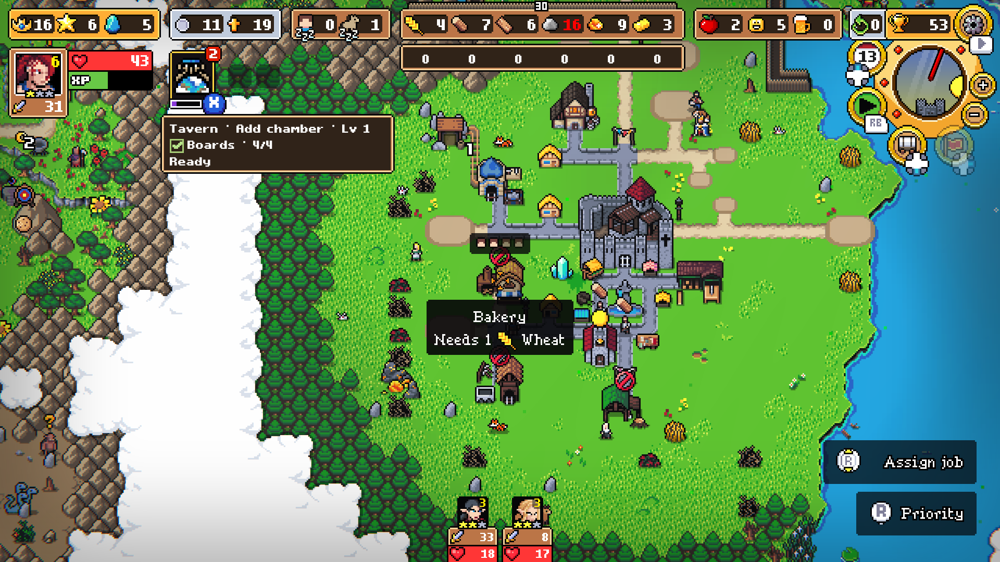
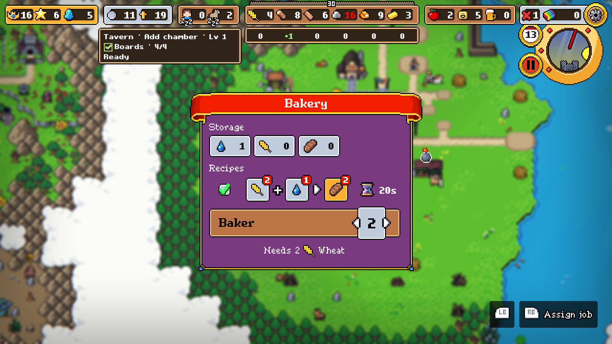
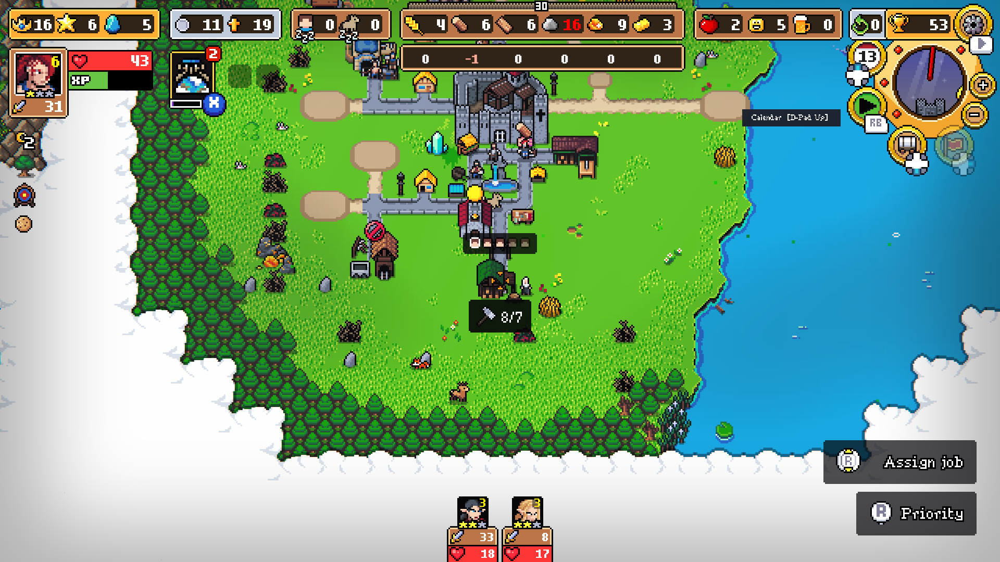

# Production Bottlenecks

Hover over a blocked production building to see what it needs. If your Bakery is waiting for an ingredient, its tooltip can show the resource icon and how many more units must reach the building.

## Features

- See the reason beneath the building name and in its selection panel. Warnings include **No worker assigned**, **Output storage full**, **Queue a task**, and **Waiting for better weather**.
- See the missing amount when the active recipe and local stock identify it. A gatherer such as a Goldmine can show **Needs Ore** with the deposit icon when the game only reports the deposit type.
- When you change worker assignments with a controller, the game's hammer icon and worker count appear beside the focused building.

## How to Use

1. Point at a building with the mouse or move the controller's world cursor onto it. The shortage appears automatically.
2. Read the line under its name. In the Bakery example below, **Needs 1 Wheat** means one more Wheat must arrive for the current recipe. Left-click the Bakery or use the controller's confirm button to compare the shortage with its storage and recipe.
3. If the line says **No worker assigned**, use the game's assignment controls while focused on the building. With default bindings, **E** adds a worker slot and **Q** removes one. On a controller, move the **right stick up** to add a slot or **down** to remove one.

<a name="in-game-examples"></a>

## Screenshots



One of two Wheat has arrived. Look beneath **Bakery** for the remaining **1 Wheat**. Captured in 0.1.3 with [BakeryUsesWheat 1.2.0](https://thunderstore.io/c/super-fantasy-kingdom/p/ownlyme/BakeryUsesWheat/).



Before the first delivery, the panel shows **Needs 2 Wheat** beneath the baker assignment. Captured in 0.1.3 at 1.5× UI scale with [BakeryUsesWheat 1.2.0](https://thunderstore.io/c/super-fantasy-kingdom/p/ownlyme/BakeryUsesWheat/).



After an assignment change, look just below the Lumberyard for the hammer and **8/7** count. Captured in 0.1.4 at 1.5× UI scale with simulated controller input.

## Compatibility

- The tooltip reads the active recipe and delivered stock. With [BakeryUsesWheat 1.2.0](https://thunderstore.io/c/super-fantasy-kingdom/p/ownlyme/BakeryUsesWheat/), the Bakery shows how much Wheat it still needs after each delivery.
- [Pin a Build Cost](https://thunderstore.io/c/super-fantasy-kingdom/p/GKJ/PinABuildCost/) and [Daybook](https://thunderstore.io/c/super-fantasy-kingdom/p/GKJ/Daybook/) were tested together with Production Bottlenecks. You can inspect a shortage while a cost is pinned or the ledger is open.
- If a mod keeps its blocking rule private and the game shows only a work warning, the tooltip can show **Idle** or **Work blocked**. Other mods' open tooltips keep priority.

## Installation

1. Choose **Install with App** on the [Thunderstore listing](https://thunderstore.io/c/super-fantasy-kingdom/p/GKJ/ProductionBottlenecks/) and select your **Super Fantasy Kingdom** profile.
2. Install the required [BepInExPack](https://thunderstore.io/c/super-fantasy-kingdom/p/BepInEx/BepInExPack/) and [HideManagerGameObject_Config](https://thunderstore.io/c/super-fantasy-kingdom/p/BepInEx/HideManagerGameObject_Config/) dependencies if your profile needs them.
3. Choose **Start modded**. Once your kingdom loads, point at a blocked production building to see its warning.

## Local import

1. In Thunderstore Mod Manager, choose **Super Fantasy Kingdom** and open your test mod profile. Install the two BepInEx dependencies listed in the manifest if the profile needs them.
2. Open **Settings**, find **Import local mod**, and select `ProductionBottlenecks-0.1.5.zip` intact.
3. Choose **Start modded**. In the profile's `BepInEx/LogOutput.log`, look for `Production Bottlenecks ready.` This confirms the plugin registered its game hooks.

## Controller playtest

The [Goldmine](docs/screenshots/0.1.2/goldmine-ore.png) and [Lumberyard](docs/screenshots/0.1.2/lumberyard-tree.png) also show the game's Ore and Tree icons when a deposit is missing.

Use a test kingdom with a staffed producer during working hours. Repeat at **UI scale 1** and **1.5**.

Park the mouse away from the building. With the controller world cursor over it, add and remove a worker using the game's assignment controls. The hammer count should follow the focused building. Switch back to mouse and keyboard and check the native worker count and shortage tooltip.

1. Set the building's worker assignment to zero. Once its last active job ends, point the world cursor at it. Expect **No worker assigned** before pressing a button. Hold and release the game's worker-details action. The status should stay with the focused building.
2. Select the building using the native confirm action. Expect the same status in its panel. Restore a worker slot using the panel controls. The message should clear or change to the next blocker. Check that the worker buttons remain reachable and the status fits alongside their prompts.
3. At a crafter with an unavailable input, wait for the game to flag the shortage. Expect **Needs** with the resource icon and name. For a recipe costing four Flour with one Flour delivered, expect **3**. Restore supply and watch it clear when work resumes. Fill the selected recipe's local output store, let the last batch finish, and check for **Output storage full**. Make room and recheck.
4. Focus a Goldmine that reports missing Ore, then a Lumberyard with a visible work sign and workers still assigned. Check the Ore sprite and the Lumberyard’s current reason. If a recipe-changing mod is enabled, switch recipes and check the new icon and remaining amount.
5. Close the panel, move focus to a different building, then point at empty ground. Check focus return and that the previous status disappears. Switch to mouse and keyboard, hover, use the existing worker-details binding, and reopen the panel. Verify the glyphs follow the active device and that the text fits at both scales.

## Build

Use a .NET SDK with .NET 8 support, Python 3, the installed Windows game, and a BepInEx 5 mod profile. The project defaults to the D: Steam library and reads BepInEx from the Daybook Dev profile. To use another installation, pass `-p:GameDir="..."` and `-p:ProfileDir="..."` to the build.

```powershell
dotnet build ProductionBottlenecks.csproj -c Release
dotnet run --project tests/StatusChecks.csproj -c Release
python package.py
```

The checks exercise production states and tooltip placement against managed fixtures. The package script verifies the archived files against the source listing and Release binary, then writes the ZIP under `dist/`. See the [compatibility checks](docs/compatibility.md) for live results at both UI scales and the remaining physical controller checks.

## Contributing and license

Bug reports and pull requests are welcome. See the [contribution guide](CONTRIBUTING.md) for local testing and reporting instructions.

The original mod code is available under the [MIT License](LICENSE). Super Fantasy Kingdom, its game assets, and third-party dependencies retain their respective licenses and ownership.
