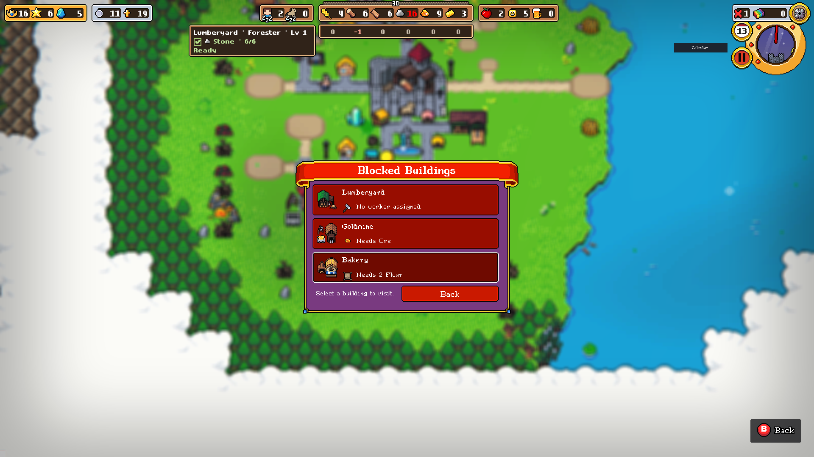
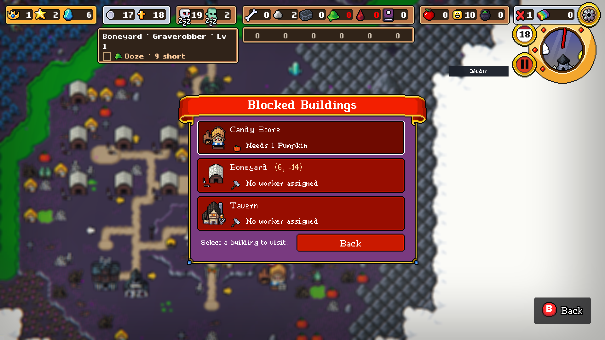

# Production Bottlenecks

See why a production building is idle and how much of an ingredient it still needs. Open **Blocked Buildings** to find a shortage elsewhere in your kingdom and visit that building.

## Features

- See the reason beneath the building name and in its selection panel. Warnings include **No worker assigned**, **Output storage full**, **Queue a task**, and **Waiting for better weather**.
- See the missing amount when the active recipe and local stock identify it. A gatherer such as a Goldmine can show **Needs Ore** with the deposit icon when the game only reports the deposit type.
- When you change worker assignments with a controller, the game's hammer icon and worker count appear beside the focused building.
- Open **Blocked Buildings** from a city building’s selection panel to see the current warnings across your kingdom. Each row shows the building icon, name, and reason. Buildings with the same name also show their map coordinates.
- Use the white stepped outline to see which button or row you’re about to activate. The wide **Back** button stays beneath the scrolling list.

## How to Use

1. Point at a building with the mouse or move the controller's world cursor onto it. The shortage appears automatically.
2. Read the line under its name. In the Human screenshot below, **Needs 2 Flour** means the Bakery’s current recipe is short by two Flour. Left-click the building or use the controller’s confirm button to inspect its storage and recipe.
3. If the line says **No worker assigned**, use the game's assignment controls while focused on the building. With default bindings, **E** adds a worker slot and **Q** removes one. On a controller, move the **right stick up** to add a slot or **down** to remove one.
4. To locate another blockage, select **Blocked Buildings** in the building panel. Navigate to a row and confirm it, or click it, to return to that building on the map. For a longer list, use the mouse wheel or navigate up and down to scroll. **Back** stays beneath the list. If overlapping buildings prevent the controller from focusing the chosen plot reliably, selecting it opens that building’s inspection panel.

## Screenshots

Human at 1×. The focused Bakery needs two Flour, the Goldmine needs Ore, and the Lumberyard needs a worker.

Undead at 1.5×. The Candy Store needs one Pumpkin. The Boneyard shows its plot coordinates and missing worker.

Both screenshots show 0.2.9 on game build 0.8.069 with virtual controller input.

## Compatibility

- The tooltip reads the active recipe and delivered stock. With [BakeryUsesWheat 1.2.0](https://thunderstore.io/c/super-fantasy-kingdom/p/ownlyme/BakeryUsesWheat/), the Bakery shows how much Wheat it still needs after each delivery.
- Tested on Super Fantasy Kingdom 0.8.070 with [Pin a Build Cost](https://thunderstore.io/c/super-fantasy-kingdom/p/GKJ/PinABuildCost/), [Daybook](https://thunderstore.io/c/super-fantasy-kingdom/p/GKJ/Daybook/), and [Worker Presets](https://thunderstore.io/c/super-fantasy-kingdom/p/GKJ/WorkerPresets/). You can read a shortage while a cost is pinned and open staffing controls from the inspected building.
- If a mod keeps its blocking rule private and the game shows only a work warning, the tooltip can show **Idle** or **Work blocked**. Other mods' open tooltips keep priority.

## Installation

1. Choose **Install with App** on the [Thunderstore listing](https://thunderstore.io/c/super-fantasy-kingdom/p/GKJ/ProductionBottlenecks/) and select your **Super Fantasy Kingdom** profile.
2. Install the required [BepInExPack](https://thunderstore.io/c/super-fantasy-kingdom/p/BepInEx/BepInExPack/) and [HideManagerGameObject_Config](https://thunderstore.io/c/super-fantasy-kingdom/p/BepInEx/HideManagerGameObject_Config/) dependencies if your profile needs them.
3. Choose **Start modded**. Once your kingdom loads, point at a blocked production building to see its warning.

[Support GKJ Games on Ko-fi](https://ko-fi.com/gkj_games)
