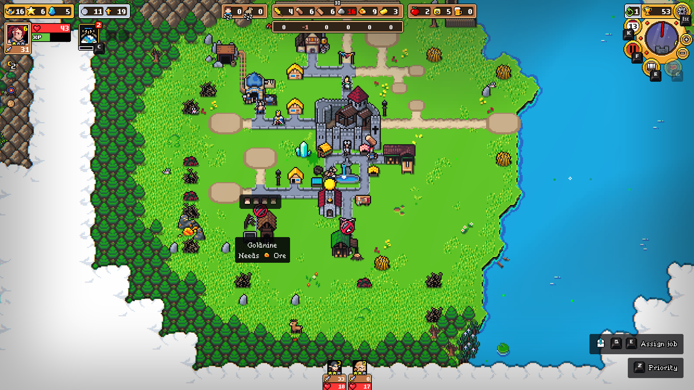
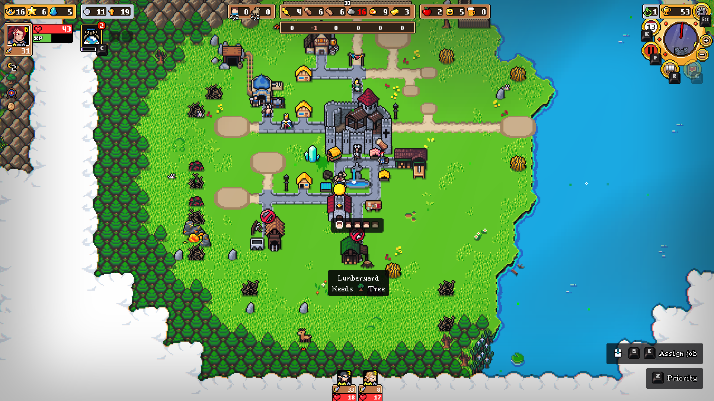

**Production Bottlenecks** shows why a building has stopped producing in **Super Fantasy Kingdom**. Hover over the building to see the reason beneath its name. Select it to see the same reason in its panel.

## What the tooltip tells you

- **Missing resource.** The tooltip shows the resource's name and game icon when available. If a recipe needs 4 Flour and the building already holds 1, it shows **Needs 3 Flour**.
- **Missing deposit.** A Goldmine can report **Needs Ore** and a Lumberyard can report **Needs Tree**, even with workers assigned. Gatherers report the deposit type without a quantity.
- **Other blockers.** The tooltip can tell you to assign a worker, free space in output storage, queue a task, or wait for better weather. If the building raises its work sign without reporting a specific cause, it shows **Idle** or **Work blocked**.

## Controls

Point at a building with the mouse or the controller's world cursor. The reason appears automatically. Use the game's usual select and worker-details actions to inspect the building or change its assignments.

## Mod compatibility

The tooltip reads the current recipe, ingredient amounts, local stock and reported shortage as you play. Changes made through those game systems appear on refresh. A custom requirement can be named when its mod reports the missing resource to the game.

## Installation

Choose **Install with App** in Thunderstore, select your **Super Fantasy Kingdom** profile, and launch with **Start modded**.

## In-game screenshots

