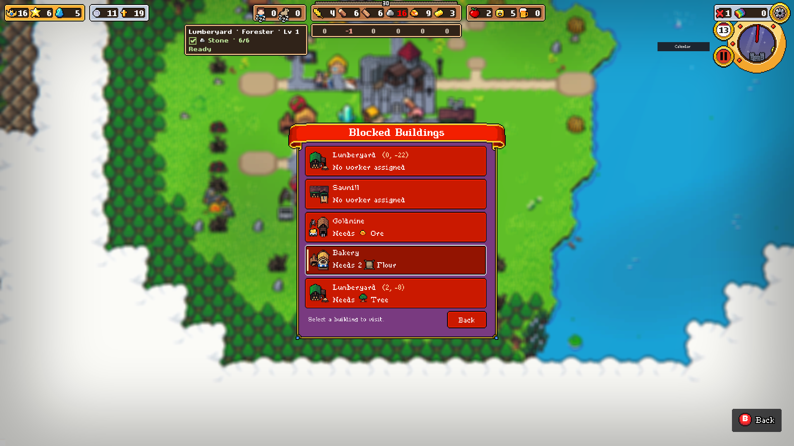
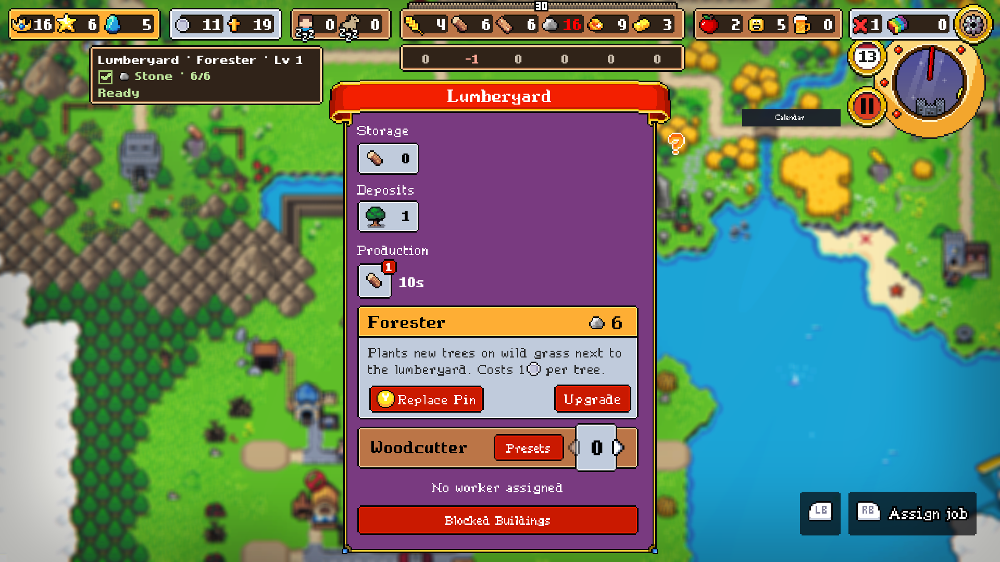

# Production Bottlenecks

See why a production building is idle and how much of an ingredient it still needs. Open **Blocked Buildings** to find a shortage elsewhere in your kingdom and visit that building.

## Features

- See the reason beneath the building name and in its selection panel. Warnings include **No worker assigned**, **Output storage full**, **Queue a task**, and **Waiting for better weather**.
- See the missing amount when the active recipe and local stock identify it. A gatherer such as a Goldmine can show **Needs Ore** with the deposit icon when the game only reports the deposit type.
- When you change worker assignments with a controller, the game's hammer icon and worker count appear beside the focused building.
- Open **Blocked Buildings** from a city building’s selection panel to see the current warnings across your kingdom. Each row shows the building icon, name, and reason. Buildings with the same name also show their map coordinates.

## How to Use

1. Point at a building with the mouse or move the controller's world cursor onto it. The shortage appears automatically.
2. Read the line under its name. In the Bakery tooltip below, **Needs 1 Wheat** means one more Wheat must arrive for the current recipe. Left-click the Bakery or use the controller's confirm button to compare the shortage with its storage and recipe.
3. If the line says **No worker assigned**, use the game's assignment controls while focused on the building. With default bindings, **E** adds a worker slot and **Q** removes one. On a controller, move the **right stick up** to add a slot or **down** to remove one.
4. To locate another blockage, select **Blocked Buildings** in the building panel. Navigate to a row and confirm it, or click it, to return to that building on the map. For a longer list, use the mouse wheel or navigate up and down to scroll. **Back** stays beneath the list. If overlapping buildings prevent the controller from focusing the chosen plot reliably, selecting it opens that building’s inspection panel.

## Screenshots

At 1×, the Bakery needs two Flour. The two Lumberyards have different plot coordinates and different blockers.

At 1.5×, selecting one of two overlapping Lumberyards opened this exact building’s inspection panel. The empty Woodcutter slot explains the warning.

One of two Wheat has arrived. Look beneath **Bakery** for the remaining **1 Wheat**.

Before the first delivery, the panel shows **Needs 2 Wheat** beneath the baker assignment.

After an assignment change, look just below the Lumberyard for the hammer and **8/7** count.

## Compatibility

- Works with Super Fantasy Kingdom **0.8.068** and the other [GKJ mods](https://thunderstore.io/c/super-fantasy-kingdom/p/GKJ/).
- Shortages use the active recipe and delivered stock. With [Bakery Uses Wheat](https://thunderstore.io/c/super-fantasy-kingdom/p/ownlyme/BakeryUsesWheat/), the Bakery tracks Wheat as its ingredient.
- The list and warnings work alongside [Pin a Build Cost](https://thunderstore.io/c/super-fantasy-kingdom/p/GKJ/PinABuildCost/), [Daybook](https://thunderstore.io/c/super-fantasy-kingdom/p/GKJ/Daybook/), and [Worker Presets](https://thunderstore.io/c/super-fantasy-kingdom/p/GKJ/WorkerPresets/). Where two buildings share a name, use the plot coordinates to pick the right one.
- If another mod keeps its production rules private, the game may only report **Idle** or **Work blocked**. An already open tooltip keeps priority.
- These community mods can share the same profile. [Achievement Enabler](https://thunderstore.io/c/super-fantasy-kingdom/p/ownlyme/AchievementEnabler/), [Bakery Uses Wheat](https://thunderstore.io/c/super-fantasy-kingdom/p/ownlyme/BakeryUsesWheat/), [More Relics](https://thunderstore.io/c/super-fantasy-kingdom/p/ownlyme/MoreRelics/), [Right Click Skip](https://thunderstore.io/c/super-fantasy-kingdom/p/ownlyme/RightClickSkip/), and [Tavern Food Priorities](https://thunderstore.io/c/super-fantasy-kingdom/p/ownlyme/TavernFoodPriorities/).

## Installation

1. Choose **Install with App** on the [Thunderstore listing](https://thunderstore.io/c/super-fantasy-kingdom/p/GKJ/ProductionBottlenecks/) and select your **Super Fantasy Kingdom** profile.
2. Install the required [BepInExPack](https://thunderstore.io/c/super-fantasy-kingdom/p/BepInEx/BepInExPack/) and [HideManagerGameObject_Config](https://thunderstore.io/c/super-fantasy-kingdom/p/BepInEx/HideManagerGameObject_Config/) dependencies if your profile needs them.
3. Choose **Start modded**. Once your kingdom loads, point at a blocked production building to see its warning.

## Support

[Support GKJ Games on Ko-fi](https://ko-fi.com/gkj_games)
